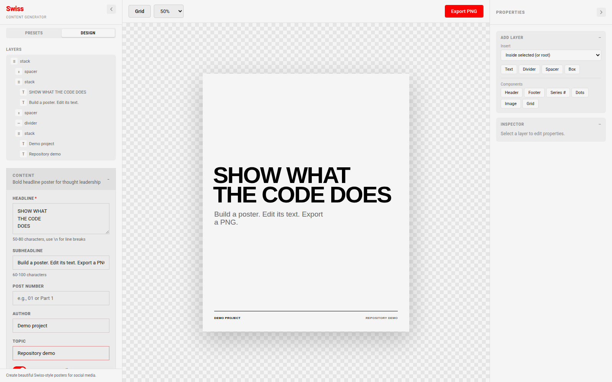

# social-post-image

A browser editor for social-media posters. Choose a layout, edit its text and
layers, change the theme or canvas size, and export a PNG.



The screenshot shows the running app with sample text. The same session
[exported this poster](docs/demo/poster.png) and saved the design to a local
MongoDB instance. No model calls were used. See [capture details](docs/demo/README.md).

## Run locally

You need Node.js 20.19 or later for the MongoDB driver, Bun for the checked-in
lockfile, and MongoDB for saved projects. The captured workflow used Bun 1.4.2
and MongoDB 8.0.

```sh
git clone https://github.com/Microapps-Labs/social-post-image.git
cd social-post-image
bun install --frozen-lockfile
cp .env.local.example .env.local
```

Edit `.env.local`. Set `AUTH_PASSWORD` to a password of your choice and generate
`AUTH_SECRET` with `openssl rand -base64 32`. Set `MONGODB_URI` to your database.
For a local-only database, Docker is one option:

```sh
docker run --detach --name social-post-image-mongo \
  --publish 127.0.0.1:27017:27017 \
  --volume social-post-image-data:/data/db \
  mongo:8.0
```

Start the app:

```sh
npm run dev -- --hostname 127.0.0.1
```

Open <http://localhost:3000>, sign in with `AUTH_PASSWORD`, then reload the editor
once. The initial project-creation request can run before sign-in; reloading
starts it with an authenticated session.

## Make a poster

1. Choose a layout under **Presets**. Selecting a preset adds a design.
2. Open **Design**, expand **Content**, and edit the text.
3. Choose a canvas size and theme. Select a layer to adjust its properties.
4. Click **Export PNG** to download the image.

Edits are saved to MongoDB after a short delay. The browser stores the current
project ID locally. The editor can render and export without a database, but
that does not save the project. Saving errors are currently silent, so confirm
important work by reloading it.

## Optional text generation

The **Generate from post** panel uses a server-side `LLM_API_KEY`. The current
implementation sends submitted text to Groq. Leave the key unset when using
presets and manual editing only. Generation was not exercised in the captured
workflow.

## Build and implementation

```sh
npm run build
npm start
```

The development workflow above was exercised; a production build has not been
qualified by this capture.

The UI renders `PosterDefinition` objects built from text, boxes, stacks, grids
and other nodes. Layout functions live in
[components/composer/presets](components/composer/presets), editable fields in
[schemas/presetSchemas.ts](schemas/presetSchemas.ts), and node types in
[lib/types.ts](lib/types.ts). The application calls itself Swiss Content
Generator in the UI.

## Deployment limits

Set explicit authentication values before hosting the app. The source includes
shared development defaults, so copying the code alone does not configure a
private deployment. The application uses one shared sign-in identity, not
separate user accounts. This repository does not include a standalone license
file.
